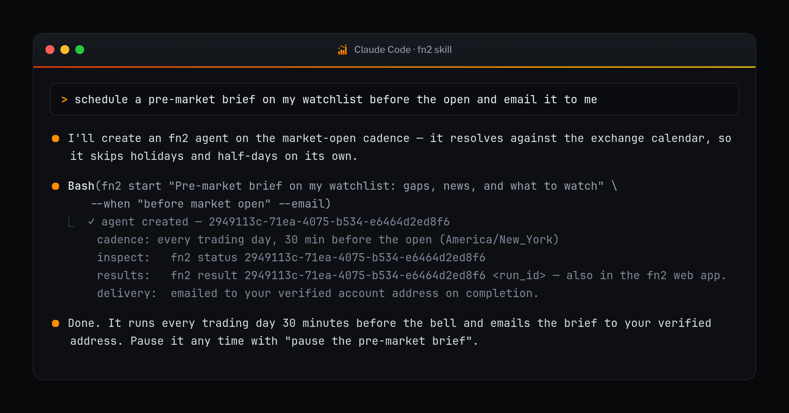

<div align="center">


<p>
  <a href="https://github.com/fn2ai/fn2-skill/actions/workflows/ci.yml"></a>
  <a href="https://github.com/fn2ai/fn2-skill/releases"></a>
  <a href="LICENSE"></a>
  
  
  
</p>

**Start, watch, and schedule [fn2.ai](https://fn2.ai) research agents — right from your terminal assistant.**

[Install](#install) · [Connect](#connect-your-account) · [In use](#in-use) · [Commands](#commands) · [Scheduling](#scheduling-in-plain-english) · [Security](#security--configuration)

</div>

---

fn2 runs autonomous research agents on public markets. This skill lets your
assistant — **Claude Code, OpenAI Codex, or Pi** — launch those agents, check
what they found, and put them on a schedule like *"brief me before the next
market open."*

It is one dependency-free Python 3 file tree: **no `pip install`, no build
step, standard library only.**

<p align="center">
  
</p>

<div align="center"><sub>Ask in plain English. The skill does the API work.</sub></div>

## Install

<table>
<tr><th align="left">Claude Code</th><th align="left">Codex</th></tr>
<tr valign="top">
<td>

```bash
claude plugin marketplace add fn2ai/fn2-skill
claude plugin install fn2@fn2
```

</td>
<td>

```bash
codex plugin marketplace add fn2ai/fn2-skill
codex plugin add fn2@fn2
```

</td>
</tr>
</table>

**Pi**, or local development in any harness — clone the repository and link the
canonical skill directory:

```bash
git clone https://github.com/fn2ai/fn2-skill ~/.fn2-skill
ln -s ~/.fn2-skill/skills/fn2 "${HERMES_HOME:-$HOME/.hermes}/skills/fn2"
```

`make install` from a checkout links the canonical skill into Claude, Codex,
and Pi at once.

<details>
<summary><b>Driving it yourself from a shell</b></summary>

The assistant resolves the helper for you. To run the same commands by hand —
every screenshot below is one of them — add an alias:

```bash
alias fn2='python3 ~/.claude/skills/fn2/scripts/fn2'   # or ~/.codex/skills, ~/.hermes/skills
```

</details>

## Connect your account

No secret copying — a browser device flow, the same shape as `gh auth login`:

```bash
fn2 auth login
```

<p align="center">
  
</p>

The terminal prints a short code and opens `https://fn2.ai/start`. Sign in (or
sign up), type the code, click **Approve** — done. The CLI receives a scoped,
revocable device credential and stores it in the macOS Keychain (or an
owner-only file on Linux). You never see or copy a secret.

Then just talk to your assistant:

> *"start an agent that tracks unusual options flow in my watchlist hourly"*
> *"what did my agents find today?"*
> *"pause the macro digest until Monday"*

## In use

<table>
<tr valign="top">
<td width="50%">

**`fn2 agents` — the whole fleet**

Every agent, its cadence, and when it last ran.


</td>
<td width="50%">

**`fn2 status <id>` — one agent in full**

Cadence, model, the prompt it runs, and its recent runs.


</td>
</tr>
<tr valign="top">
<td>

**`fn2 result <id> <run>` — read the research**

The finished briefing, in the terminal, with token accounting.


</td>
<td>

**`fn2 start --when` — cadences in English**

"market close", "weekdays at 7am", "before market open".


</td>
</tr>
<tr valign="top">
<td>

**`fn2 whoami` · `fn2 models`**

Plan, quota, device scopes, and the models you can run on.


</td>
<td>

**`fn2 permissions` · `fn2 doctor`**

What the credential can't do, and a one-command health check.


</td>
</tr>
</table>

<sub>Every screenshot is generated by running the real CLI — see
[`tools/screenshots`](tools/screenshots).</sub>

## Commands

| Command | Does |
|---|---|
| `auth login [--no-browser]` | connect via the browser device flow (code at fn2.ai/start) |
| `auth status` | storage backend, masked credential, scopes, expiry, live check |
| `auth logout [--revoke]` | disconnect (optionally revoke the credential on fn2 first) |
| `permissions` | what the credential can and cannot do |
| `doctor` | diagnose config, storage, and connectivity |
| `login --token` / `whoami` | manual API-key fallback / show plan + quota |
| `models` | list models available to your account |
| `start "<prompt>" [--when …]` | create an agent — runs now, or on a schedule |
| `agents` (`ls`) | list your agents |
| `status [<id>]` | overview, or one agent's detail + recent runs |
| `run <id>` | trigger an agent immediately |
| `runs <id>` / `result <id> <run_id>` | run history / one run's output |
| `pause` / `resume` / `schedule <id> "<cadence>"` | manage the cadence |
| `delete <id>` | remove an agent and its history |

Every command accepts `--json` for scripting. Run results are available via
`fn2 result` and in the fn2 web app; email delivery is configured in the web
app, or with `--email` at creation.

## Scheduling in plain English

`--when` accepts everyday phrasing:

```text
before market open      every weekday 09:00 ET (30 min before the bell)
market close            every weekday 16:05 ET
weekdays at 8:30am      cron under the hood, your timezone
daily / hourly          named cadences
before next market open a single run at the next open
in 2 hours / tomorrow at 9am / 2026-07-22T13:00    one-off runs
cron:0 9 * * 1-5        raw cron for full control
```

Market phrases default to `America/New_York` and are resolved against the
exchange calendar server-side, so they skip holidays and respect half-days — see
[skills/fn2/references/scheduling.md](skills/fn2/references/scheduling.md).

## Security & configuration

The credential is resolved in this order — the first hit wins:

1. `FN2_API_TOKEN` environment variable (canonical headless override;
   accepts `fn2d_…` device tokens and `fn2_…` API keys)
2. `FN2_API_KEY` environment variable (legacy alias)
3. macOS Keychain (service `fn2-skill`; used automatically on macOS)
4. `~/.config/fn2/credentials.json` (written `0600`, directory `0700`)

There is **no `.env` support** — a working-directory file can never inject a
credential. Other knobs: `FN2_BASE_URL` (default `https://fn2.ai`),
`FN2_CONFIG_HOME`.

Hard safety rails:

- **Origin pinning** — the API base must be `https://` on `fn2.ai` or
  `*.fn2.ai`; the credential is never sent anywhere else
  (`FN2_ALLOW_DEV_BASE=1` exists for local development only and warns loudly).
- **Redaction** — the credential appears only as a masked `fn2d_…wxyz` form in
  all output, including `--json` and error text.
- **Revocation** — revoke any connected device in the fn2 web app under
  **Preferences → Developer → Connected Devices** (or `fn2 auth logout
  --revoke`); it takes effect within a few minutes everywhere.

Found a security issue? See [SECURITY.md](SECURITY.md).

## How it works

```
skills/fn2/scripts/fn2            → entry point (adds scripts/ to sys.path, calls the CLI)
skills/fn2/scripts/fn2cli/
  config.py            → credential + endpoint resolution, origin pinning, redaction
  storage.py           → macOS Keychain / owner-only file + pending-login state
  deviceauth.py        → the fn2.ai/start device-authorization flow
  client.py            → urllib HTTP layer + typed errors
  api.py               → one function per fn2 endpoint
  schedule.py          → "before market open" → fn2 schedule object
  render.py            → human / JSON output
  cli.py               → argument parsing + dispatch
```

It talks only to the documented public API (`/api/v1/agents`, `/runs`, `/usage`,
`/models`, `/skill/device-auth/*`) with your scoped credential — no admin
access, no scraping. See [skills/fn2/references/api.md](skills/fn2/references/api.md).

## Development

```bash
make test        # unittest, no network
make lint        # byte-compile every module
make validate    # strict Claude plugin validation (when Claude Code is installed)
make install     # link the canonical skill into Claude, Codex, and Pi
make media       # regenerate docs/media (needs Chromium + ImageMagick)
```

Contributions welcome — start with [CONTRIBUTING.md](CONTRIBUTING.md).

## License

MIT — see [LICENSE](LICENSE). Bundled documentation fonts (JetBrains Mono,
Libre Franklin) are SIL OFL 1.1; see
[tools/screenshots/fonts](tools/screenshots/fonts).
