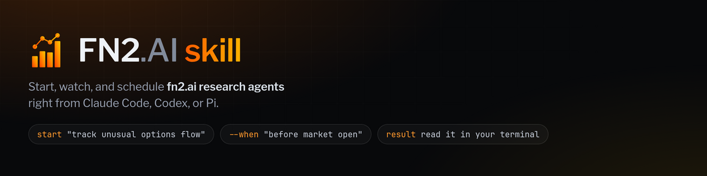
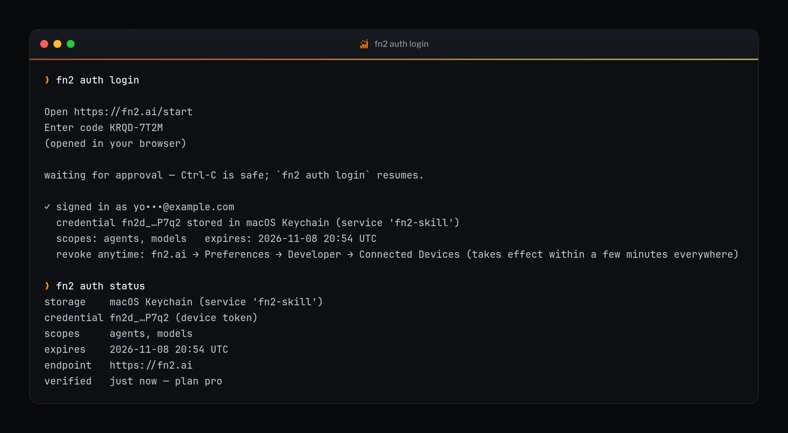
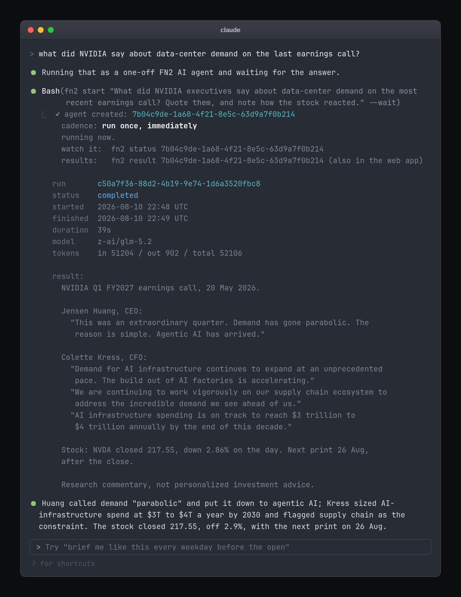
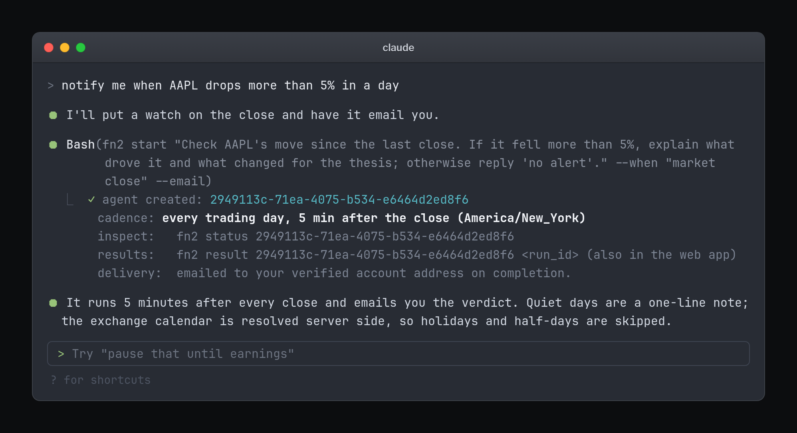
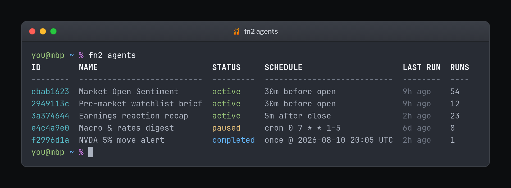
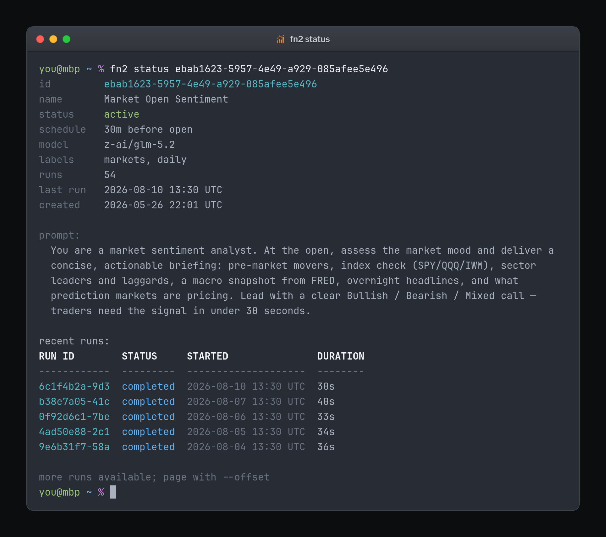
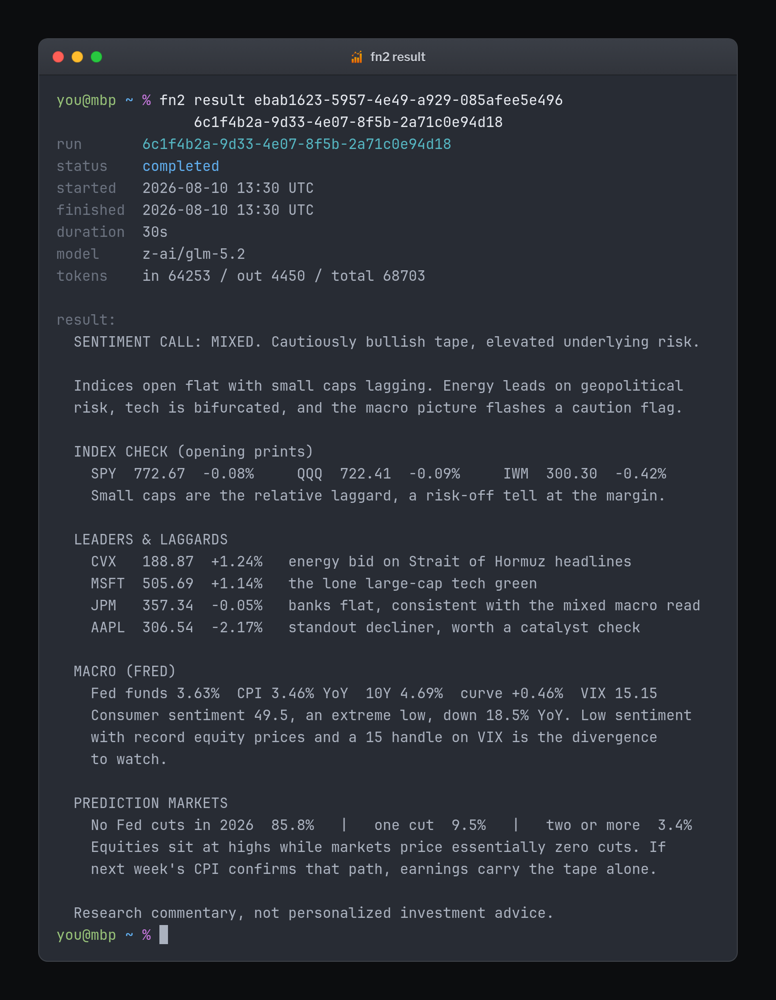
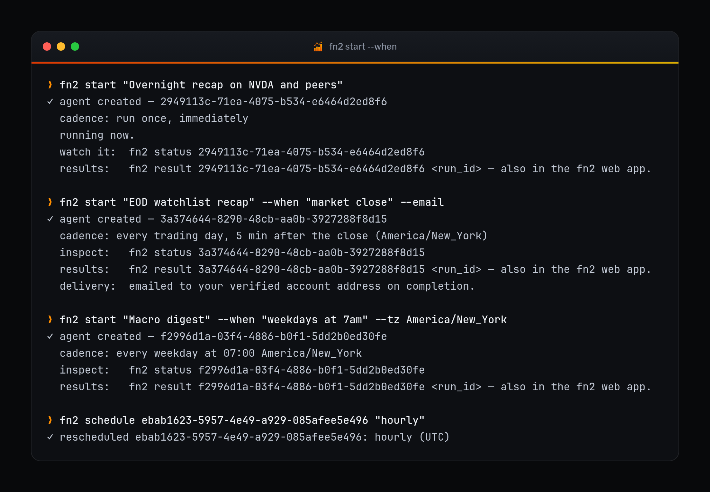
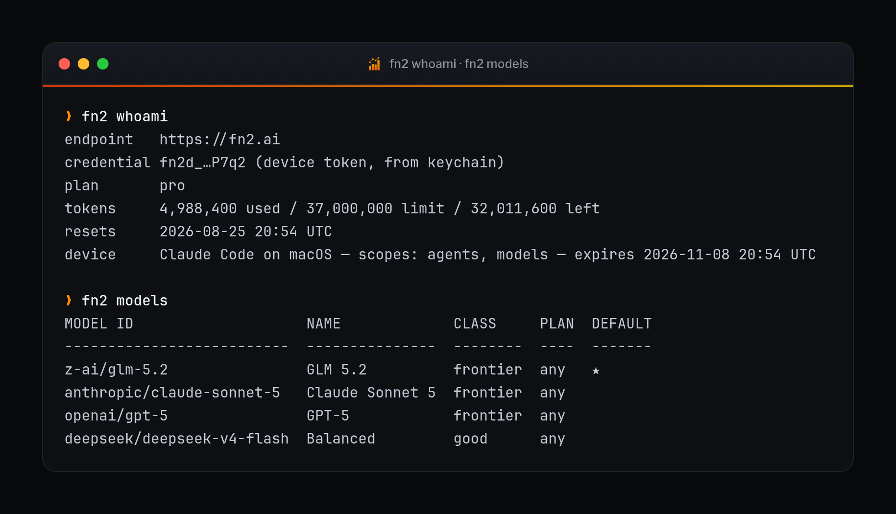
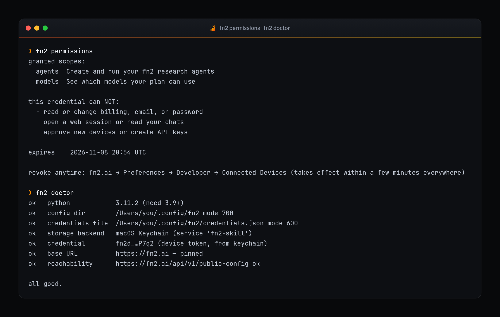

<div align="center">



<p>
  <a href="https://github.com/fn2ai/fn2-skill/actions/workflows/ci.yml"></a>
  <a href="https://github.com/fn2ai/fn2-skill/releases"></a>
  <a href="LICENSE"></a>
  
  
  
</p>

**Ask [FN2 AI](https://fn2.ai) anything about public markets, then put the good questions on a schedule. From your terminal.**

[Get started](#get-started) · [Run it yourself](#running-it-yourself) · [In use](#in-use) · [Commands](#commands) · [Scheduling](#scheduling-in-everyday-words) · [Security](#security-and-configuration)

</div>

---

## Get started

**1. Install the skill.** One command; nothing else to set up (standard-library
Python, zero dependencies, no build step).

<table>
<tr><th align="left">Claude Code</th><th align="left">Codex</th></tr>
<tr valign="top">
<td>

```bash
claude plugin marketplace add fn2ai/fn2-skill
claude plugin install fn2@fn2
```

</td>
<td>

```bash
codex plugin marketplace add fn2ai/fn2-skill
codex plugin add fn2@fn2
```

</td>
</tr>
</table>

**2. Connect your account.** Ask your assistant, in as many words:

> *"connect my FN2 AI account"*

Your assistant shows you a short sign-in code and opens
[fn2.ai/start](https://fn2.ai/start) in your browser (if no tab appears, it
gives you the link to click). Sign in or create an account, enter the code,
click **Approve**, done: the CLI receives a scoped, revocable device
credential and stores it in the macOS Keychain (or an owner-only file on
Linux). You never see or copy a secret.

<p align="center">
  
</p>

**3. Ask something.**

> *"what did NVIDIA say about data-center demand on the last earnings call?"*

That is the whole setup. Installing for **Pi**, working from a checkout, or
wanting the `fn2` command in your own terminal: see
[Install details](#install-details).

---

FN2 AI runs autonomous research agents on public markets: earnings-call
transcripts, prices and volume, SEC filings, FRED macro series, prediction
markets, and the news around them. This skill hands that to your assistant, so
**Claude Code, OpenAI Codex, or Pi** can launch an agent, read what it found,
and put it on a cadence.

Things worth asking:

- **Earnings calls.** *"What did NVIDIA say about data-center demand on the last call?"* Answered with the executives' own words.
- **Price action.** *"How is NVDA trading today, and what moved it?"*
- **Standing watches.** *"Notify me when AAPL drops more than 5% in a day."*
- **The daily brief.** *"Brief me on my watchlist every weekday before the open."*
- **Macro and filings.** *"Where is the yield curve now versus a year ago?"* · *"What changed in TSLA's latest 10-Q?"*
- **What the market is pricing.** *"What odds are prediction markets giving a Fed cut this year?"*

It is one dependency-free Python 3 file tree: **no `pip install`, no build
step, standard library only.**

<p align="center">
  
</p>

<div align="center"><sub>Ask in natural language. The skill does the API work.</sub></div>

## Install details

The one-command install is under [Get started](#get-started). **Pi**, or local
development in any harness: clone the repository and link the canonical skill
directory.

```bash
git clone https://github.com/fn2ai/fn2-skill ~/.fn2-skill
ln -s ~/.fn2-skill/skills/fn2 "${HERMES_HOME:-$HOME/.hermes}/skills/fn2"
```

`make install` from a checkout links the canonical skill into Claude, Codex,
and Pi at once.

A plugin installs a **skill**, not a binary, so nothing lands on your `PATH`.
Usually that is fine: you talk to your assistant, not to a shell command. If
you want `fn2` in your own terminal too, run this once (or just ask your
assistant to "put fn2 on my PATH"):

```bash
python3 "${CLAUDE_CONFIG_DIR:-$HOME/.claude}"/plugins/cache/fn2/fn2/*/skills/fn2/scripts/fn2 link
```

That writes a small launcher into the first writable `bin` directory on your
`PATH` and tells you if there isn't one. The launcher re-resolves the skill on
every run, so plugin updates do not strand it. `fn2 unlink` removes it.

Once linked, `fn2 auth login` is the same browser device flow as asking your
assistant to connect: code in the terminal, approval at `fn2.ai/start`,
credential in the Keychain.

## Running it yourself

Every screenshot in this README is a command you can run once `fn2 link` has
put the launcher on your `PATH`. A few things make it quick to live in:

```bash
fn2 agents                       # ids print 8 characters wide...
fn2 status ebab1623              # ...and 8 characters is enough to refer back
fn2 status "market open"         # so is a name
fn2 result ebab1623              # newest run, no run id to copy
fn2 start "..." --wait           # ask and get the answer in one command
fn2 run ebab1623 --wait          # trigger and block until it finishes
```

Ambiguous references are refused with the candidates listed, never guessed.
`--wait` uses the API's own long-poll rather than hammering it, and takes
`--timeout` (default 300s); Ctrl-C is always safe.

Output is colourised when it is going to a terminal and plain everywhere else.
`--color never` and `NO_COLOR` both turn it off; `--json` is never colourised.
On a console that cannot encode `✓`, the glyphs fall back to ASCII instead of
raising `UnicodeEncodeError`.

## In use

**Standing watches, in one sentence.**

<p align="center">
  
</p>

<table>
<tr valign="top">
<td width="50%">

**`fn2 agents`, the whole fleet**

Every agent, its cadence, and when it last ran.



</td>
<td width="50%">

**`fn2 status <id>`, one agent in full**

Cadence, model, the prompt it runs, and its recent runs.



</td>
</tr>
<tr valign="top">
<td>

**`fn2 result <id> <run>`, read the research**

The finished briefing, in the terminal, with token accounting.



</td>
<td>

**`fn2 start --when`, cadences in words**

"market close", "weekdays at 7am", "before market open".



</td>
</tr>
<tr valign="top">
<td>

**`fn2 whoami` and `fn2 models`**

Plan, quota, device scopes, and the models you can run on.



</td>
<td>

**`fn2 permissions` and `fn2 doctor`**

What the credential cannot do, and a one-command health check.



</td>
</tr>
</table>

<sub>Every screenshot is generated by running the real CLI. See
[`tools/screenshots`](tools/screenshots).</sub>

## Commands

Any command that takes an agent takes an **id, an id prefix, or a name**.

| Command | Does |
|---|---|
| `link` / `unlink` | put an `fn2` launcher on your PATH, or take it off |
| `auth login [--no-browser] [--no-wait]` | connect via the browser device flow (code at fn2.ai/start); `--no-wait` prints the code and returns, a later `auth login` finishes |
| `auth status` | storage backend, masked credential, scopes, expiry, live check |
| `auth logout [--revoke]` | disconnect (optionally revoke the credential on FN2 AI first) |
| `permissions` | what the credential can and cannot do |
| `doctor` | diagnose config, storage, and connectivity |
| `login --token` / `whoami` | manual API-key fallback / show plan + quota |
| `models` | list models available to your account |
| `start "<prompt>" [--when …] [--wait]` | create an agent: runs now, or on a schedule |
| `agents` (`ls`) | list your agents |
| `status [<id>]` | overview, or one agent's detail + recent runs |
| `run <id> [--wait]` | trigger an agent immediately |
| `runs <id>` / `result <id> [run_id]` | run history / one run's output (default: newest) |
| `pause` / `resume` / `schedule <id> "<cadence>"` | manage the cadence |
| `delete <id>` | remove an agent and its history |

Every command accepts `--json` for scripting. Run results are available via
`fn2 result` and in the FN2 AI web app; add `--email` at creation to have each
completed run delivered to your verified address.

## Scheduling in everyday words

`--when` accepts ordinary phrasing:

```text
before market open      every weekday 09:00 ET (30 min before the bell)
market close            every weekday 16:05 ET
weekdays at 8:30am      cron under the hood, your timezone
daily / hourly          named cadences
before next market open a single run at the next open
in 2 hours / tomorrow at 9am / 2026-07-22T13:00    one-off runs
cron:0 9 * * 1-5        raw cron for full control
```

Market phrases default to `America/New_York` and resolve against the exchange
calendar server side, so they skip holidays and respect half-days. See
[skills/fn2/references/scheduling.md](skills/fn2/references/scheduling.md).

## Security and configuration

The credential is resolved in this order, first hit wins:

1. `FN2_API_TOKEN` environment variable (canonical headless override;
   accepts `fn2d_…` device tokens and `fn2_…` API keys)
2. `FN2_API_KEY` environment variable (legacy alias)
3. macOS Keychain (service `fn2-skill`; used automatically on macOS)
4. `~/.config/fn2/credentials.json` (written `0600`, directory `0700`)

There is **no `.env` support**, so a working-directory file can never inject a
credential. Other knobs: `FN2_BASE_URL` (default `https://fn2.ai`),
`FN2_CONFIG_HOME`.

Hard safety rails:

- **Origin pinning.** The API base must be `https://` on `fn2.ai` or
  `*.fn2.ai`; the credential is never sent anywhere else
  (`FN2_ALLOW_DEV_BASE=1` exists for local development only and warns loudly).
- **Redaction.** The credential appears only as a masked `fn2d_…wxyz` form in
  all output, including `--json` and error text.
- **Revocation.** Revoke any connected device in the FN2 AI web app under
  **Preferences → Developer → Connected Devices** (or `fn2 auth logout
  --revoke`); it takes effect within a few minutes everywhere.

Found a security issue? See [SECURITY.md](SECURITY.md).

## How it works

```
skills/fn2/scripts/fn2            → entry point (adds scripts/ to sys.path, calls the CLI)
skills/fn2/scripts/fn2cli/
  config.py            → credential + endpoint resolution, origin pinning, redaction
  storage.py           → macOS Keychain / owner-only file + pending-login state
  deviceauth.py        → the fn2.ai/start device-authorization flow
  client.py            → urllib HTTP layer + typed errors
  api.py               → one function per FN2 AI endpoint
  schedule.py          → "before market open" into an FN2 AI schedule object
  render.py            → human / JSON output
  style.py             → ANSI colour + glyph fallback, off unless stdout is a terminal
  cli.py               → argument parsing + dispatch
```

It talks only to the documented public API (`/api/v1/agents`, `/runs`, `/usage`,
`/models`, `/skill/device-auth/*`) with your scoped credential. No admin access,
no scraping. See [skills/fn2/references/api.md](skills/fn2/references/api.md).

## Development

```bash
make test        # unittest, no network
make lint        # byte-compile every module
make validate    # strict Claude plugin validation (when Claude Code is installed)
make install     # link the canonical skill into Claude, Codex, and Pi
make media       # regenerate docs/media (needs Chromium + ImageMagick)
```

Contributions welcome. Start with [CONTRIBUTING.md](CONTRIBUTING.md).

## License

MIT, see [LICENSE](LICENSE). Bundled documentation fonts (JetBrains Mono,
Libre Franklin) are SIL OFL 1.1; see
[tools/screenshots/fonts](tools/screenshots/fonts).
